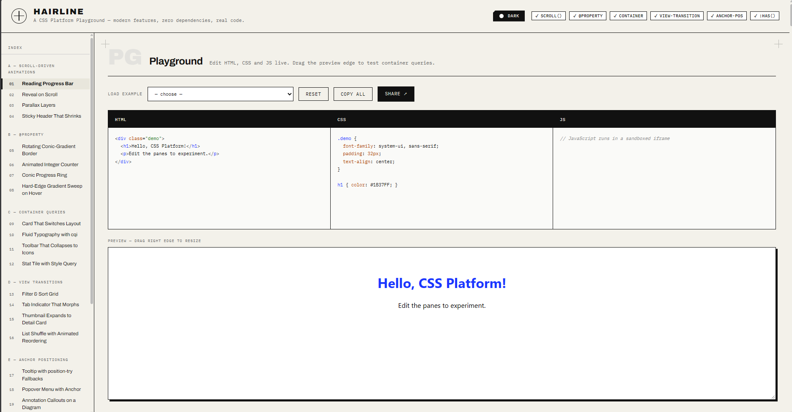

# Hacktiv8 × IBM SkillsBuild × ITS — IT Capstone Project: HAIRLINE CSS Platform Playground

<div align="center">


</div>

---



## 📋 Description

**HAIRLINE** is a single-page, dependency-free CSS Platform Playground. It showcases **25 hand-crafted UI components** built exclusively with modern CSS features, lets visitors read the exact HTML, CSS and JS source behind each component, and provides a live code editor (playground) to experiment in real time.

The project is intended as both a **portfolio piece** and a **learning reference** for front-end developers who want to see scroll-driven animations, `@property`, container queries, view transitions, anchor positioning, and `:has()` used in real, production-quality code.

> 🤖 This project was entirely designed and generated with the assistance of **IBM Bob** (IBM's AI software engineering assistant), based on a detailed prompt specification by the project author.

---

## 🚀 Getting Started

### Prerequisites

No installation, no build step, no npm. The only external resource is a Google Fonts import (Archivo + IBM Plex Mono) declared in `styles.css`.

| Resource                                                         | Version      | Purpose                 |
| ---------------------------------------------------------------- | ------------ | ----------------------- |
| [Archivo](https://fonts.google.com/specimen/Archivo)             | Google Fonts | Display & body typeface |
| [IBM Plex Mono](https://fonts.google.com/specimen/IBM+Plex+Mono) | Google Fonts | Code & label typeface   |

### Running the Project

Open `index.html` directly in an evergreen browser (Chrome 120+, Firefox 121+, Safari 17+), or serve with a one-liner:

```bash
# Node.js
npx serve .

# Python
python -m http.server 8080
```

No fetch calls, no CORS issues — works as a plain `file://` open.

---

## 📁 Project Structure

```
capstone-it/
├── index.html    # Semantic HTML shell — layout, playground markup, skip link
├── styles.css    # Full design system — tokens, dark theme, all component styles
├── app.js        # All logic — examples data, render engine, highlighter,
│                 #              tabs, copy, playground, support detection,
│                 #              nav rail, theme toggle
└── README.md     # This file
```

**Hard constraint satisfied:** exactly three deliverable files. No frameworks, no build step, no CDN scripts.

---

## ✨ Features

### 🔬 25 Live CSS Specimens

Every specimen panel contains:

- A header bar with its index (`07 / 25`), title, feature tag chips, and a browser-support note
- A **demo stage** running the actual code from the example data object
- Code tabs for **HTML**, **CSS**, and **JS** with syntax highlighting, a **Copy** button, and an **Open in Playground** button
- If no JS is needed, the JS tab shows `// No JavaScript needed`

**Single source of truth:** each example is defined once as a plain object (`id`, `title`, `tags`, `html`, `css`, `js`, `support`). The demo stage and the code tabs are both rendered from those same strings — the shown code can never drift from the running code.

### 📚 Example Groups

| Group | Feature                  | Examples                                                                                      |
| ----- | ------------------------ | --------------------------------------------------------------------------------------------- |
| **A** | Scroll-Driven Animations | Reading progress bar, reveal on scroll, parallax layers, shrinking sticky header              |
| **B** | `@property`              | Conic-gradient border, animated integer counter, conic progress ring, gradient sweep          |
| **C** | Container Queries        | Layout-switching card, fluid `cqi` typography, collapsing toolbar, `style()` stat tile        |
| **D** | View Transitions         | Filter/sort grid, morphing tab indicator, thumbnail expand, list shuffle                      |
| **E** | Anchor Positioning       | Tooltip with `position-try`, popover menu, annotation callouts, hover-following nav indicator |
| **F** | `:has()`                 | Checked-card restyle, form validity states, quantity-aware grid, sibling dimming              |
| **G** | Bonus                    | `@starting-style` dialog entry animation                                                      |

Every new feature is wrapped in `@supports` with a documented graceful fallback — nothing breaks in an unsupported browser.

### 🛝 Playground

- Three editable panes (HTML, CSS, JS) with **live syntax highlighting** — a `<pre>` overlay behind a transparent `<textarea>`, kept pixel-perfect in sync
- **Tab key** inserts 2 spaces instead of losing focus
- **Live preview** inside a sandboxed `<iframe srcdoc>`, debounced 250 ms
- Preview wrapper is **horizontally resizable** (CSS `resize: horizontal`) to test container queries by dragging
- **Load Example** dropdown populates any of the 25 examples into the editors
- **Reset** restores the default starter code
- **Copy all** copies the combined HTML + CSS + JS to clipboard
- **Share** encodes the current editor state to a base64 URL hash — paste the URL and the exact state is restored
- Runtime JS errors from the iframe are shown in a red error strip below the preview

### 🎨 Design System

Direction: **sharp-edge, technical, editorial** — engineering drawing meets modern print design.

| Token            | Light                       | Dark                        |
| ---------------- | --------------------------- | --------------------------- |
| Background       | `#F3F1EA` warm bone         | `#0E0E0C` near-black        |
| Panel            | `#FFFFFF`                   | `#1C1C19`                   |
| Ink (text)       | `#111111`                   | `#E8E5DC` warm off-white    |
| Accent           | `#FFFFFF` (on ink surfaces) | `#FFFFFF`                   |
| Lime (sparingly) | `#C8FF00`                   | `#B8ED00`                   |
| Border           | `1.5px solid #111111`       | `1.5px solid #3A3835`       |
| Shadow           | `4px 4px 0 ink`             | `4px 4px 0 rgba(0,0,0,0.7)` |

- `border-radius: 0` everywhere; chamfered corners via `clip-path polygon()` on selected elements
- Hard offset shadows (no blur), never glassmorphism
- Typefaces: **Archivo** (display/body) + **IBM Plex Mono** (code/labels)
- All design tokens as CSS custom properties at the top of `styles.css`

### 🌗 Theme Toggle

- Button in the header switches between light and dark mode
- Preference persisted in `localStorage` under key `hairline-theme`
- Falls back to the OS `prefers-color-scheme` preference on first visit
- Follows OS changes live if no manual override is stored
- Dark theme applied via `[data-theme="dark"]` on `<html>` — no `@media` conflict
- All syntax highlight colours swap automatically via `--hl-*` custom properties

### ♿ Accessibility & Quality

- Semantic HTML: `<header>`, `<nav>`, `<main>`, `<section>`, `<article>`, `<footer>`
- Skip link to main content
- Visible `:focus-visible` outlines on all interactive elements
- `aria-label`, `aria-selected`, `aria-controls`, `aria-hidden`, `role` used throughout
- `prefers-reduced-motion`: all `animation-duration` and `transition-duration` cut to `0.001ms`
- WCAG AA contrast on all text pairs in both themes (verified by relative-luminance calculation)
- Responsive from 360 px up; nav rail collapses on small screens

---

## 📝 Prompt Specification

This project was built by IBM Bob following this exact prompt by the project author:

> _"Build 'HAIRLINE', a CSS Platform Playground. It is a single-page web app that does two things: (1) showcases many small, well-crafted UI components built with new CSS features — scroll-driven animations, @property, container queries, view transitions, anchor positioning, and :has(). (2) lets visitors read the exact HTML, CSS and JS behind each component, and edit the code live in a playground._
>
> _Exactly three files: index.html, styles.css, app.js. No frameworks, no build step, no npm packages, no CDN scripts or CSS libraries. Fonts are the only external resource allowed._
>
> _Every example is rendered as a 'specimen' panel. Single source of truth: the code shown in the tabs and the code running the demo come from the same strings. Inject each example's CSS at document level in its own `<style>` tag. Prefix every class and custom property with the example id._
>
> _Playground: three editable panes, live preview in a sandboxed iframe, horizontally resizable, persist state in URL hash. Show runtime JS errors._
>
> _Design: sharp-edge, technical, editorial. border-radius 0 everywhere. Hard offset shadows, never blurred. Warm bone background, near-black ink, white accent. Archivo + IBM Plex Mono. Dark mode toggle with localStorage persistence._
>
> _Minimum 24 examples across 6 groups. Every new feature wrapped in @supports with a graceful fallback. Never fake a demo."_

### What IBM Bob Built

| File         | Lines | Responsibility                                                                                                                                                                                                                                                                  |
| ------------ | ----- | ------------------------------------------------------------------------------------------------------------------------------------------------------------------------------------------------------------------------------------------------------------------------------- |
| `index.html` | ~200  | Semantic shell, skip link, header with feature support chips and theme toggle, nav rail, playground markup with pre-overlay editors, footer                                                                                                                                     |
| `styles.css` | ~1000 | Full design system — `:root` light tokens, `[data-theme="dark"]` dark tokens, all component styles, syntax highlight colour tokens, playground overlay layout, utility classes                                                                                                  |
| `app.js`     | ~1250 | § 1 Examples data (25 objects) · § 2 Syntax highlighter (tag-by-token HTML parser, CSS & JS highlighters) · § 3 Render engine · § 4 Tabs & copy · § 5 Playground highlight overlay · § 6 Playground logic · § 7 Support detection · § 8 Nav rail · § 9 Theme toggle · § 10 Init |

IBM Bob additionally:

- Audited all three files for class/ID consistency and JavaScript correctness before delivery
- Repaired the HTML syntax highlighter twice — first to prevent attribute-regex cross-tag bleed, then replaced it with a proper tag-by-token parser that works on raw strings before HTML-escaping to handle entities (e.g. `&#9660;`) inside attribute values without producing leaked `class=` attributes in the rendered output
- Fixed dark-mode contrast: replaced `--clr-border: #F0EEE6` (same colour as text — caused glowing borders) with `#3A3835`, replaced warm-white box shadows with `rgba(0,0,0,0.7)`, raised muted text from 4.37:1 to 5.44:1
- Added the playground syntax highlight overlay system after initial delivery

---

## 🛠 Tech Stack

| Technology                       | Role                                                                                                                                                               |
| -------------------------------- | ------------------------------------------------------------------------------------------------------------------------------------------------------------------ |
| **HTML5**                        | Semantic structure — `<header>`, `<nav>`, `<main>`, `<section>`, `<article>`, `<footer>`                                                                           |
| **CSS3 (vanilla, no framework)** | Custom properties, `@property`, `@container`, `@supports`, scroll-driven animations, anchor positioning, `:has()`, view transitions, `clip-path`, `conic-gradient` |
| **Vanilla JavaScript (ES6+)**    | DOM rendering, IntersectionObserver, `CSS.supports()`, `CSS.registerProperty()`, `document.startViewTransition()`, `localStorage`, URL hash encode/decode          |

---

## 🌐 Browser Support

| Feature                         | Chrome | Firefox  | Safari  | Fallback                         |
| ------------------------------- | ------ | -------- | ------- | -------------------------------- |
| `scroll()` / `view()` timelines | ✓ 115+ | ✓ 110+   | ✓ 17.2+ | Elements static / always-visible |
| `@property`                     | ✓ 85+  | ✓ 128+   | ✓ 16.4+ | Static colours / borders         |
| Container queries               | ✓ 105+ | ✓ 110+   | ✓ 16+   | Stacked layout always            |
| View Transitions                | ✓ 111+ | ✗ (flag) | ✓ 18+   | Instant DOM update, no animation |
| Anchor positioning              | ✓ 125+ | ✗        | ✗       | Static `absolute` positioning    |
| `:has()`                        | ✓ 105+ | ✓ 121+   | ✓ 15.4+ | No relational styling            |

> Recommended: **Chrome 125+** for the full feature set including anchor positioning.

---

## 📜 License

This project is submitted as part of the **Hacktiv8 × IBM SkillsBuild × ITS Data Science Capstone Project**. All rights reserved by the author.

---

<div align="center">

Created with 💖 by **Ahmad Fakhrul Bawani** and **IBM Bob** (IBM's AI Software Engineering Assistant)

_Hacktiv8 × IBM SkillsBuild × ITS — Data Science Capstone Project · 2026_

</div>
